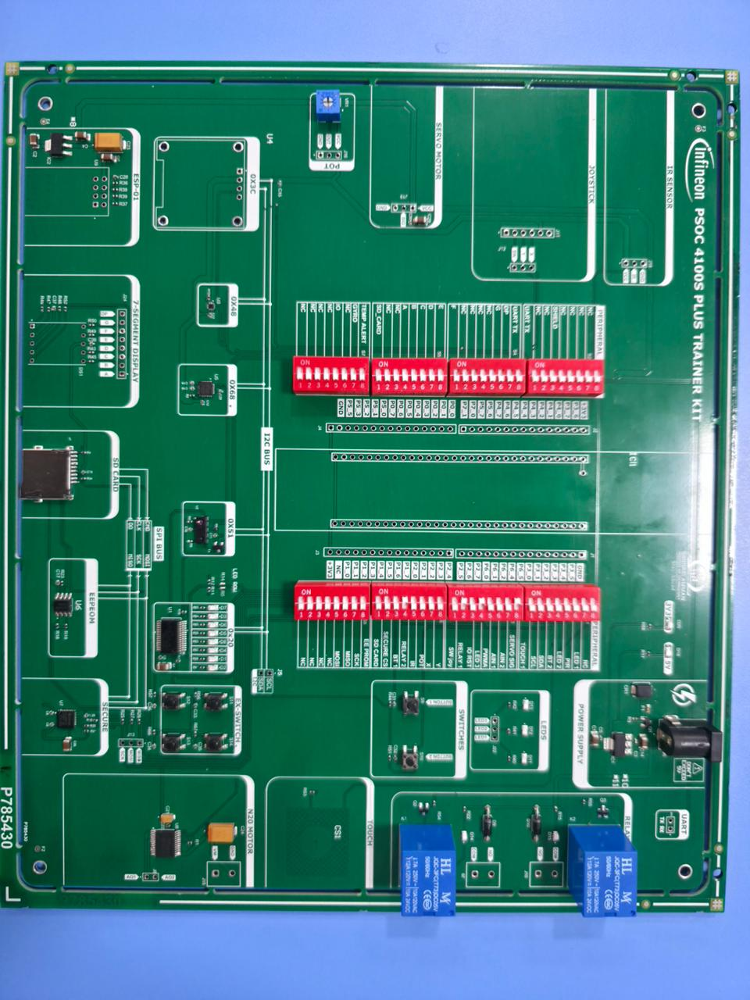
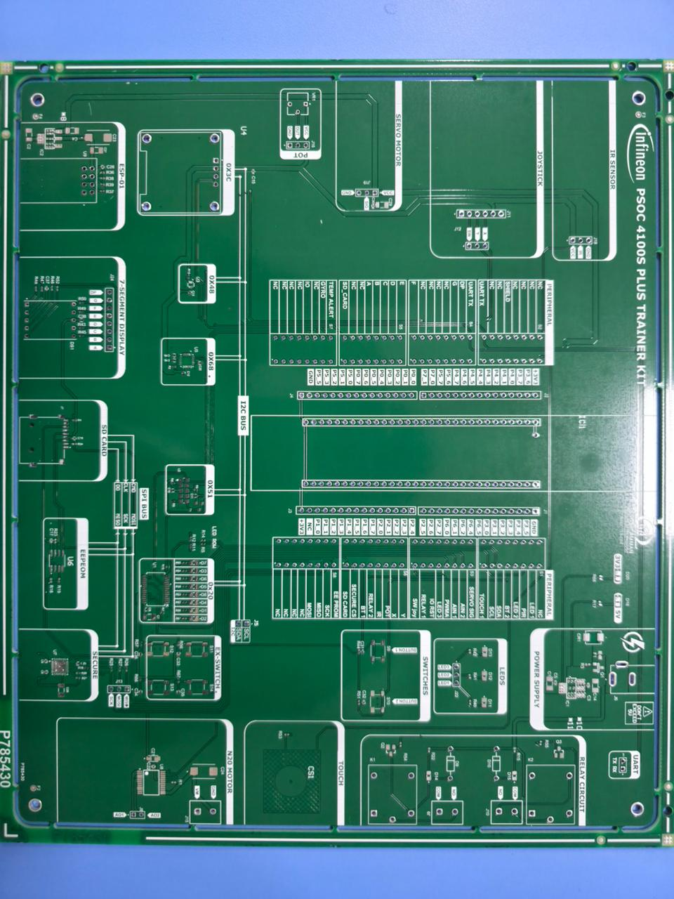
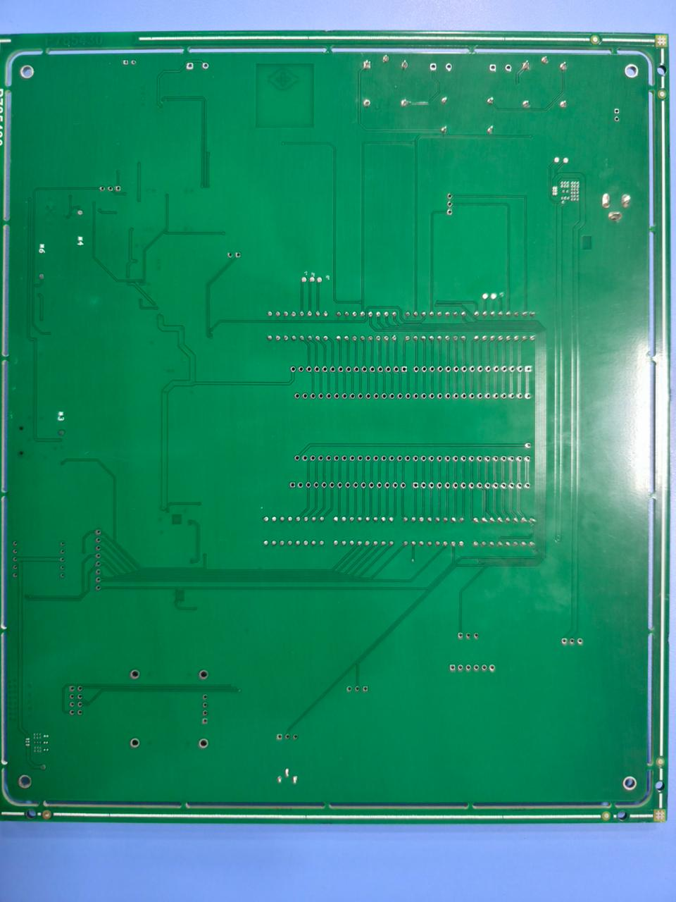
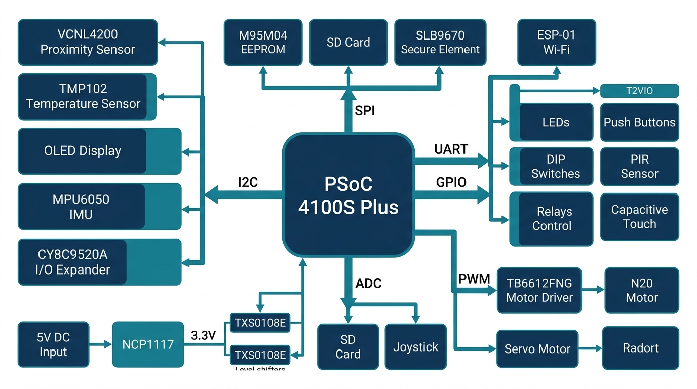

<p align="center">
  
</p>

<h1 align="center">PSoC 4100S Plus Trainer Kit</h1>

<p align="center">
  <strong>A Comprehensive Embedded Systems Development & Educational Platform</strong>
</p>

<p align="center">
  <a href="#features">Features</a> •
  <a href="#hardware-overview">Hardware Overview</a> •
  <a href="#getting-started">Getting Started</a> •
  <a href="#peripheral-reference">Peripheral Reference</a> •
  <a href="#design-files">Design Files</a> •
  <a href="#license">License</a>
</p>

<p align="center">
  
  
  
  
</p>

---

## Table of Contents

- [Overview](#overview)
- [Features](#features)
- [Board Images](#board-images)
- [System Architecture](#system-architecture)
- [Hardware Overview](#hardware-overview)
  - [Main Controller](#main-controller)
  - [I²C Peripherals](#i²c-peripherals)
  - [SPI Peripherals](#spi-peripherals)
  - [UART & Wireless](#uart--wireless)
  - [User Input Peripherals](#user-input-peripherals)
  - [Display & Visual Output](#display--visual-output)
  - [Sensors](#sensors)
  - [Motor & Actuator Control](#motor--actuator-control)
  - [Power System](#power-system)
  - [Level Shifting & Signal Conditioning](#level-shifting--signal-conditioning)
  - [Protection & Reliability](#protection--reliability)
- [Peripheral Reference](#peripheral-reference)
  - [I²C Address Map](#i²c-address-map)
  - [SPI Chip Select Map](#spi-chip-select-map)
  - [Communication Interface Summary](#communication-interface-summary)
- [Pin Allocation Summary](#pin-allocation-summary)
- [Getting Started](#getting-started)
  - [Prerequisites](#prerequisites)
  - [Power-Up Procedure](#power-up-procedure)
  - [Development Environment](#development-environment)
- [Design Files](#design-files)
- [Typical Applications](#typical-applications)
- [Learning Objectives](#learning-objectives)
- [Contributing](#contributing)
- [License](#license)

---

## Overview

The **PSoC 4100S Plus Trainer Kit** is a single-board embedded learning platform that integrates a wide range of sensors, displays, communication interfaces, memory devices, input peripherals, actuators, wireless connectivity, and security hardware — all centred around the **Infineon PSoC 4100S Plus** microcontroller.

This trainer eliminates the need for multiple external breakout modules and jumper-wire setups by consolidating commonly used embedded peripherals directly on one board. It is designed for:

- **Students** learning embedded systems fundamentals
- **Developers** prototyping IoT and sensor-fusion applications
- **Educators** delivering structured lab experiments
- **Engineers** evaluating PSoC 4100S Plus capabilities

---

## Features

| Category | Highlights |
|---|---|
| **Communication** | I²C, SPI, UART, GPIO, ADC, PWM — all on one board |
| **Sensors** | Proximity (VCNL4200), Temperature (TMP102), IMU (MPU6050), PIR, IR |
| **Displays** | I²C OLED, 7-Segment Display, Status LEDs |
| **Storage** | SPI EEPROM (M95M04), SD Card Slot |
| **Wireless** | ESP-01 Wi-Fi Module (UART) |
| **Security** | SLB9670VQ2.0 TPM Secure Element (SPI) |
| **Actuators** | N20 DC Motor + TB6612FNG Driver, Servo Motor, 2× Relay Circuits |
| **Input** | Push Buttons, DIP Switches, Joystick, Potentiometer, Capacitive Touch |
| **I/O Expansion** | CY8C9520A I²C I/O Expander |
| **Power** | 5V DC Input, NCP1117 3.3V Regulator, Fuse/ESD/Reverse-polarity Protection |
| **Level Shifting** | TXS0108E, SN74LVC2T45, TXU0104 |

---

## Board Images

### Populated Board — Top View

<p align="center">
  
</p>

### Unpopulated PCB — Top View

<p align="center">
  
</p>

### PCB — Bottom View

<p align="center">
  
</p>

---

## System Architecture

<p align="center">
  
</p>

The PSoC 4100S Plus controller sits at the centre of the architecture and communicates with all onboard peripherals through six main interface buses:

```
                         ┌─────────────────────────────┐
                         │    PSoC 4100S Plus MCU       │
                         │                              │
                         │  ARM Cortex-M0+ | 48 MHz     │
                         │  Flash | SRAM | CapSense     │
                         └──┬───┬───┬───┬───┬───┬───────┘
                            │   │   │   │   │   │
                   ┌────────┘   │   │   │   │   └────────┐
                   │            │   │   │   │            │
                 I²C          SPI UART GPIO  ADC        PWM
                   │            │   │   │   │            │
          ┌────────┴───┐   ┌────┴┐  │  ┌┴┐ ┌┴──┐   ┌────┴────┐
          │ VCNL4200   │   │EEPROM│ │  │L│ │POT│   │TB6612FNG│
          │ TMP102     │   │SD    │ │  │E│ │IR │   │+ N20    │
          │ OLED       │   │Secure│ │  │D│ │JOY│   │Servo    │
          │ MPU6050    │   └──────┘ │  │s│ └───┘   └─────────┘
          │ I/O Exp.   │        ┌───┘  │B│
          └────────────┘        │ESP-01││t│
                                └──────┘│n│
                                        │s│
                                        └─┘
```

---

## Hardware Overview

### Main Controller

| Parameter | Details |
|---|---|
| **MCU** | Infineon PSoC 4100S Plus |
| **Core** | ARM Cortex-M0+ |
| **Interfaces Used** | I²C, SPI, UART, GPIO, ADC, PWM |
| **CapSense** | Integrated capacitive touch engine |

The PSoC controller connects to all onboard peripherals and exposes its pins through organized header strips for easy signal tracing and DIP-switch configuration.

---

### I²C Peripherals

| # | Device | Function | I²C Address | Interrupt |
|---|---|---|---|---|
| 1 | **VCNL4200** | Proximity & Ambient Light Sensor | `0x51` | Yes |
| 2 | **TMP102** | Digital Temperature Sensor | `0x48` | Alert output |
| 3 | **OLED Display** | 128×64 I²C OLED | `0x3C` | — |
| 4 | **MPU6050** | 6-Axis IMU (Accel + Gyro) | `0x68` | Yes |
| 5 | **CY8C9520A** | I/O Expander (Switches + LEDs) | `0x20` | Yes (+ Reset) |

> **Note:** All I²C devices share a common bus with pull-up resistors and are accessible through the labelled **I2C BUS** section on the PCB.

---

### SPI Peripherals

| # | Device | Function | Chip Select |
|---|---|---|---|
| 1 | **M95M04** | 4 Mbit SPI EEPROM | Dedicated CS |
| 2 | **SD Card** | External Mass Storage | Dedicated CS |
| 3 | **SLB9670VQ2.0** | TPM 2.0 Secure Element | Dedicated CS + INT |

All SPI peripherals share the **MOSI**, **MISO**, and **SCK** lines on the **SPI BUS** with individual chip-select signals.

---

### UART & Wireless

| Device | Interface | Signals | Application |
|---|---|---|---|
| **ESP-01** | UART | TX, RX | Wi-Fi / IoT Communication |

The ESP-01 module enables wireless connectivity for IoT projects, remote sensor monitoring, and cloud data transmission using standard AT commands or custom firmware.

---

### User Input Peripherals

| Input Device | Type | Interface | Notes |
|---|---|---|---|
| **Push Buttons** | Digital | GPIO | Multiple buttons for interrupt/input experiments |
| **DIP Switches** | Digital | GPIO | Binary configuration and input testing |
| **Joystick** | Analog + Digital | ADC (X, Y) + GPIO (SW) | 2-axis analog + push-button |
| **Potentiometer** | Analog | ADC | Adjustable voltage for ADC experiments |
| **Capacitive Touch** | Touch | CapSense | Multiple touch pads |

---

### Display & Visual Output

| Display | Interface | Usage |
|---|---|---|
| **OLED Display** | I²C (`0x3C`) | Text, graphics, sensor readouts, debug info |
| **7-Segment Display** | GPIO | Numeric display, counters, status codes |
| **LEDs** | GPIO | Status indication, blink patterns, visual debug |

---

### Sensors

| Sensor | Measurement | Interface | Output |
|---|---|---|---|
| **VCNL4200** | Proximity + Ambient Light | I²C | Digital + Interrupt |
| **TMP102** | Temperature (−25°C to +85°C) | I²C | Digital + Alert |
| **MPU6050** | 3-Axis Accel + 3-Axis Gyro | I²C | Digital + Interrupt |
| **PIR Sensor** | Human Motion Detection | GPIO | Digital |
| **IR Sensor** | Object / Distance Detection | ADC | Analog |

---

### Motor & Actuator Control

#### DC Motor

| Parameter | Details |
|---|---|
| **Motor** | N20 DC Motor |
| **Driver** | TB6612FNG Dual H-Bridge |
| **Control Signals** | AIN1, AIN2 (Direction) · PWMA (Speed) · STBY (Standby) |
| **Interface** | GPIO + PWM |

#### Servo Motor

| Parameter | Details |
|---|---|
| **Control** | PWM Signal |
| **Application** | Angular position control |

#### Relay Circuits (×2)

Each relay circuit includes a relay, driver transistor, flyback diode, and status LED.

| Parameter | Details |
|---|---|
| **Quantity** | 2 |
| **Control** | GPIO (digital output) |
| **Application** | External load switching, home automation |

---

### Power System

```
 ┌────────────┐     ┌──────┐     ┌──────────┐     ┌──────────┐
 │ 5V DC      │────▶│ Fuse │────▶│ Reverse-  │────▶│ ESD      │
 │ Adaptor    │     │      │     │ Polarity  │     │ Protect  │
 └────────────┘     └──────┘     │ Protect   │     └────┬─────┘
                                 └──────────┘          │
                                                       ▼
                                               ┌──────────────┐
                                  5V Rail ◀────│  Power Bus   │
                                               │              │
                                 3.3V Rail ◀───│  NCP1117     │
                                               │  LDO Reg.   │
                                               └──────────────┘
```

| Parameter | Details |
|---|---|
| **Input** | 5V DC via Barrel Connector |
| **Regulator** | NCP1117 (5V → 3.3V) |
| **Protection** | Fuse, Reverse-polarity, ESD, Decoupling capacitors |
| **Rails** | 5V (peripherals) and 3.3V (logic) |

---

### Level Shifting & Signal Conditioning

| Level Shifter | Application |
|---|---|
| **TXS0108E** | Bidirectional 8-bit level translation (GPIO, SPI, misc.) |
| **SN74LVC2T45** | Dual-bit level translation (I²C signals, interrupts) |
| **TXU0104** | 4-bit unidirectional translation (UART, control lines) |

Level shifters ensure reliable communication between the 3.3V PSoC domain and 5V peripheral domain.

---

### Protection & Reliability

- ✅ **Fuse protection** — overcurrent safeguard
- ✅ **Reverse-polarity protection** — prevents damage from incorrect power wiring
- ✅ **ESD protection** — on power and signal lines
- ✅ **Power filtering** — input and local decoupling capacitors
- ✅ **Pull-up resistors** — on I²C bus, SPI CS, and interrupt lines
- ✅ **Test points** — exposed pads for oscilloscope/multimeter probing

---

## Peripheral Reference

### I²C Address Map

| Address | Device | Description |
|---|---|---|
| `0x20` | CY8C9520A | I/O Expander |
| `0x3C` | OLED Display | 128×64 Graphic Display |
| `0x48` | TMP102 | Temperature Sensor |
| `0x51` | VCNL4200 | Proximity & ALS |
| `0x68` | MPU6050 | 6-Axis IMU |

### SPI Chip Select Map

| CS Signal | Device |
|---|---|
| `EEPROM_CS` | M95M04 SPI EEPROM |
| `SD_CARD_CS` | SD Card Interface |
| `SECURE_CS` | SLB9670VQ2.0 TPM |

### Communication Interface Summary

| Interface | Devices Connected | Signal Lines |
|---|---|---|
| **I²C** | VCNL4200, TMP102, OLED, MPU6050, CY8C9520A | SDA, SCL |
| **SPI** | M95M04, SD Card, SLB9670 | MOSI, MISO, SCK, CS×3 |
| **UART** | ESP-01 | TX, RX |
| **GPIO** | LEDs, Buttons, DIP Switches, PIR, Relays, Touch | Various |
| **ADC** | Potentiometer, IR Sensor, Joystick (X, Y) | Analog pins |
| **PWM** | TB6612FNG (N20 Motor), Servo Motor | PWM output pins |

---

## Pin Allocation Summary

| PSoC Pin Function | Connected Peripheral / Signal |
|---|---|
| I²C SDA | I²C Bus (shared) |
| I²C SCL | I²C Bus (shared) |
| SPI MOSI | SPI Bus (shared) |
| SPI MISO | SPI Bus (shared) |
| SPI SCK | SPI Bus (shared) |
| SPI CS0 | M95M04 EEPROM |
| SPI CS1 | SD Card |
| SPI CS2 | SLB9670 Secure Element |
| UART TX | ESP-01 RX |
| UART RX | ESP-01 TX |
| PWM A | TB6612FNG PWMA |
| AIN1 | TB6612FNG Direction |
| AIN2 | TB6612FNG Direction |
| STBY | TB6612FNG Standby |
| SERVO SIG | Servo Motor PWM |
| RELAY 1 | Relay Circuit 1 |
| RELAY 2 | Relay Circuit 2 |
| ADC (POT) | Potentiometer |
| ADC (IR) | IR Sensor |
| ADC (JOY X) | Joystick X-axis |
| ADC (JOY Y) | Joystick Y-axis |
| GPIO (LEDs) | LED Outputs |
| GPIO (BTN) | Push Buttons |
| GPIO (DIP) | DIP Switch Inputs |
| GPIO (PIR) | PIR Sensor |
| CapSense | Capacitive Touch Pads |

> Refer to the on-board silkscreen and the **Peripheral Headers** for exact pin-to-header mapping.

---

## Getting Started

### Prerequisites

| Requirement | Details |
|---|---|
| **Power Supply** | 5V DC Adaptor (centre-positive barrel jack) |
| **IDE** | [Infineon ModusToolbox™](https://www.infineon.com/modustoolbox) or PSoC Creator |
| **Programmer** | KitProg / MiniProg4 (or compatible SWD debugger) |
| **Cable** | USB cable for programming interface |

### Power-Up Procedure

1. Connect a **5V DC adaptor** to the barrel jack.
2. Verify the **power LED** illuminates.
3. Connect the programmer/debugger via the programming header.
4. Launch your IDE and create or open a PSoC 4100S Plus project.

### Development Environment

```
1. Install ModusToolbox™ or PSoC Creator
2. Select "PSoC 4100S Plus" as the target device
3. Configure the required peripherals (I²C, SPI, UART, etc.)
4. Build and program the firmware
5. Monitor output via OLED, Serial Terminal, or Debug probe
```

---

## Design Files

This repository includes the complete hardware design package:

```
📁 Design_Files/
├── Block_Diagram.SchDoc        # Top-level block diagram (Altium)
├── PSOC_ControllerSchDoc.SchDoc # PSoC controller schematic
├── PSOC_I2C_BUS.SchDoc         # I²C bus schematic
├── PSOC_SPI_BUS.SchDoc         # SPI bus schematic
├── PSOC_PERI_2.SchDoc          # Additional peripherals schematic
├── PSOC.PrjPcb                 # Altium project file
├── PSOC_LAY.PcbDoc             # PCB layout
├── PSOC.BomDoc                 # Bill of Materials
├── PSOC.IntLib                 # Integrated component library
├── PcbLib1.PcbLib              # PCB footprint library
└── PSOC.OutJob                 # Output job configuration

📁 Gerber/
└── PSOC.zip                    # Manufacturing-ready Gerber files

📁 Images/
├── POPULATED_TOP_VIEW.jpeg     # Assembled board photo
├── UnPopulated_TOP_VIEW.jpeg   # Bare PCB photo
├── BOTTOM_VIEW.jpeg            # PCB bottom view
└── Block_Diagram.jpg           # System block diagram
```

> **EDA Tool:** Altium Designer  
> **Board ID:** P785430

---

## Typical Applications

- 🌡️ **Environmental Monitoring** — Temperature, proximity, and motion sensing
- 📡 **IoT Sensor Nodes** — Wi-Fi-connected sensor dashboards
- 💾 **Data Logging Systems** — SD card and EEPROM storage
- ⚙️ **Motor Control** — DC motor speed/direction + servo positioning
- 🏠 **Home Automation** — Relay-based load control with wireless interface
- 🔒 **Secure Embedded Systems** — TPM-based authentication and secure storage
- 🖐️ **HMI Applications** — Capacitive touch + OLED display interfaces
- 🏭 **Industrial Control Demos** — Relay switching, sensor monitoring, PWM drives

---

## Learning Objectives

This trainer kit provides hands-on experience with **20 core embedded systems topics**:

| # | Topic | # | Topic |
|---|---|---|---|
| 1 | PSoC Microcontroller Programming | 11 | SD Card Data Logging |
| 2 | GPIO Configuration | 12 | Wi-Fi Communication |
| 3 | I²C Communication Protocol | 13 | DC Motor Control |
| 4 | SPI Communication Protocol | 14 | Servo Motor Control |
| 5 | UART Communication Protocol | 15 | Relay Control |
| 6 | ADC Operation & Conversion | 16 | Capacitive Touch Sensing |
| 7 | PWM Generation | 17 | Embedded Security (TPM) |
| 8 | Sensor Interfacing | 18 | Interrupt Handling |
| 9 | Display Interfacing (OLED, 7-Seg) | 19 | Level Shifting |
| 10 | Non-Volatile Data Storage | 20 | Hardware Debugging (Test Points) |

---

## Contributing

Contributions are welcome! If you'd like to improve the design, add example firmware, or fix documentation:

1. Fork this repository
2. Create a feature branch (`git checkout -b feature/your-feature`)
3. Commit your changes (`git commit -m "Add: your feature description"`)
4. Push to the branch (`git push origin feature/your-feature`)
5. Open a Pull Request

---

## License

This project is provided for **educational and development purposes**.  
Please contact the project maintainers for licensing details regarding commercial use.

---

<p align="center">
  <strong>Designed for Infineon PSoC 4100S Plus</strong><br/>
  <em>An all-in-one embedded trainer platform — from GPIO to IoT.</em>
</p>
